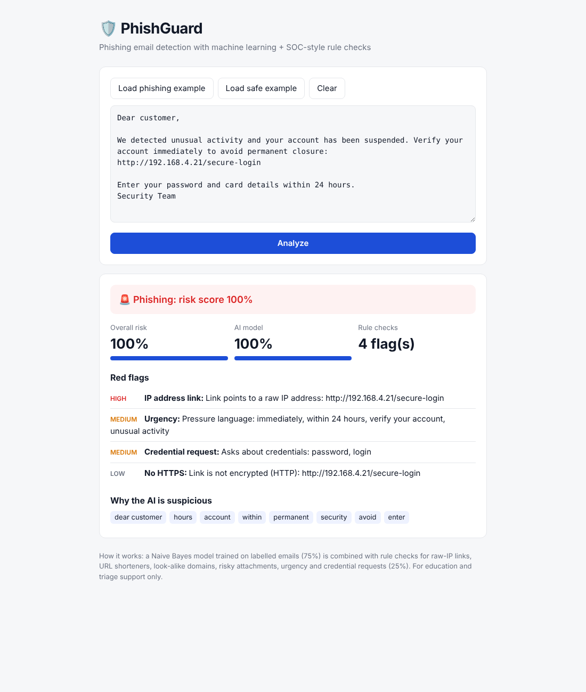
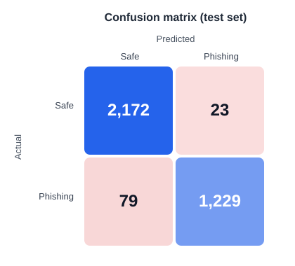

# 🛡️ PhishGuard: AI Phishing Email Detector

PhishGuard flags phishing emails by combining a **machine-learning classifier written from scratch** with **SOC-style rule checks**, and explains *why* an email looks suspicious, the way an analyst would triage it.

**Zero dependencies:** the model, metrics and web app use only the Python standard library, so it runs on locked-down machines where scientific libraries can't be installed.



## Features

- **Naive Bayes classifier, implemented from scratch**: word and two-word-phrase features, Laplace smoothing, log-probabilities for numerical stability
- **10 security rules**: raw-IP links, URL shorteners, `@`-obfuscated links, look-alike (punycode) domains, non-HTTPS links, complex domains, risky attachments (`.exe`, `.zip`, `.js`…), urgency, credential requests and reward bait
- **Combined verdict**: Phishing / Suspicious / Safe from a weighted risk score (75% model, 25% rules)
- **Explainability**: every red flag is shown with its severity, plus the words that pushed the model toward "phishing"
- **Evaluation report**: accuracy, precision, recall, F1, ROC-AUC and a confusion-matrix chart saved to `reports/`
- **Web interface** built on Python's `http.server`, with no framework needed
- **Unit tests** with `pytest`

## How it works

```
email text ──► tokenize (words + bigrams) ──► Naive Bayes ──► ML probability ─┐
           │                                                                  ├─► risk score ─► verdict
           └─► rule engine (links, files, wording) ─────────────► rule score ─┘
```

Naive Bayes learns how often each word appears in phishing vs. safe emails, then uses Bayes' theorem:

```
log P(class | email)  ∝  log P(class) + Σ log P(word | class)
```

## Project structure

```
phishguard/
├── phishguard/
│   ├── text.py       # tokenization: lowercase, placeholders for links/numbers, bigrams
│   ├── model.py      # Naive Bayes from scratch + combined verdict
│   ├── rules.py      # rule-based red-flag detection
│   ├── data.py       # CSV loading (auto-detects columns) + stratified split
│   ├── metrics.py    # accuracy, precision, recall, F1, ROC-AUC, confusion matrix
│   └── static/index.html   # web interface
├── tests/            # pytest unit tests
├── data/             # put the dataset here (not committed)
├── reports/          # metrics.json + confusion_matrix.svg after training
├── train.py          # train and evaluate
└── app.py            # run the web app
```

## Quick start

Requires Python 3.10+. Nothing else to install.

```bash
# 1. Download a phishing dataset from Kaggle and save it as data/emails.csv (see data/README.md)

# 2. Train and evaluate
python train.py

# 3. Launch the app (opens http://localhost:8501)
python app.py

# Optional: run the tests
pip install pytest
pytest
```

## Results

Trained on the Kaggle **Phishing Email Detection** dataset (17,521 unique emails) and evaluated on a held-out, stratified 20% test set (3,503 emails):

| Metric | Score |
|---|---|
| Accuracy | 97.1% |
| Precision | 98.2% |
| **Recall (phishing caught)** | **94.0%** |
| F1 | 96.0% |
| ROC-AUC | 99.1% |

**79 phishing emails missed, 23 false alarms** out of 3,503 test emails.



**Why recall matters most:** a missed phishing email (false negative) can lead to stolen credentials, while a false alarm only costs a few seconds of a user's time.

## Design decisions

- **Why Naive Bayes?** It's a classic, proven approach for spam and phishing filtering: fast to train, works well on text, and easy to explain word by word.
- **Why from scratch?** It shows the maths behind the model, and it removes compiled dependencies that application-control policies on corporate machines often block.
- **Why combine ML with rules?** The model learns wording patterns. The rules catch technical tricks (raw-IP links, shorteners, risky files) that wording alone can miss.

## Limitations

- **CEO fraud / Business Email Compromise** is harder to catch: a polite "buy gift cards for me, keep it between us" email with no links scored only *Suspicious* (47%) in testing.
- The dataset mixes phishing with older spam, so the model also learns dataset artifacts (e.g. `nbsp` HTML leftovers, pharmacy spam words).
- Attackers can rephrase emails to avoid the words the model learned (adversarial wording).
- Only the email body is analysed; headers (SPF, DKIM, DMARC, sender domain) are not checked yet.
- Images and attachments are not scanned, only mentioned file names.
- Results depend on the training data; models trained on older datasets may miss new campaigns.

## Roadmap

- [ ] Add a CEO-fraud rule (gift-card / wire-transfer requests, secrecy, "I'm in a meeting")
- [ ] Parse real `.eml` files and check SPF/DKIM/DMARC headers
- [ ] Check links against a threat-intelligence feed (e.g. URLhaus, VirusTotal)
- [ ] Compare against Logistic Regression and a transformer model
- [ ] Batch mode for scanning a folder of emails

## Tech stack

Python standard library (`re`, `csv`, `math`, `http.server`, `json`) · HTML/CSS/JavaScript · pytest

## Disclaimer

For education and triage support only. It does not replace an email security gateway or your security team.
